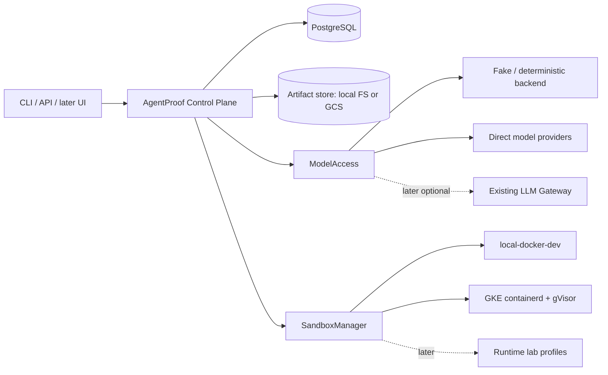
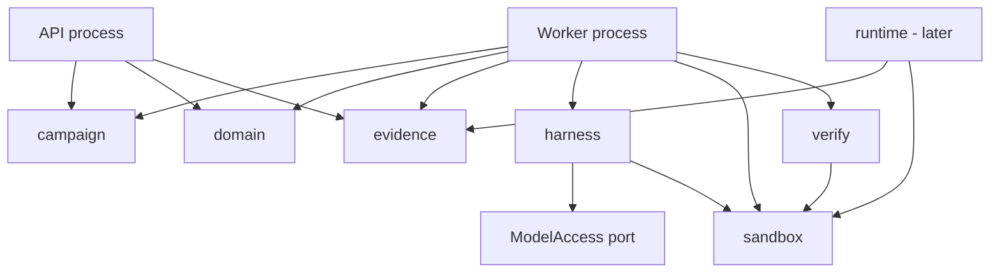
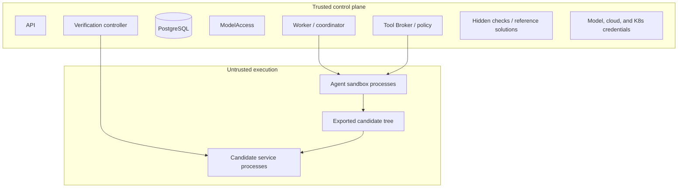
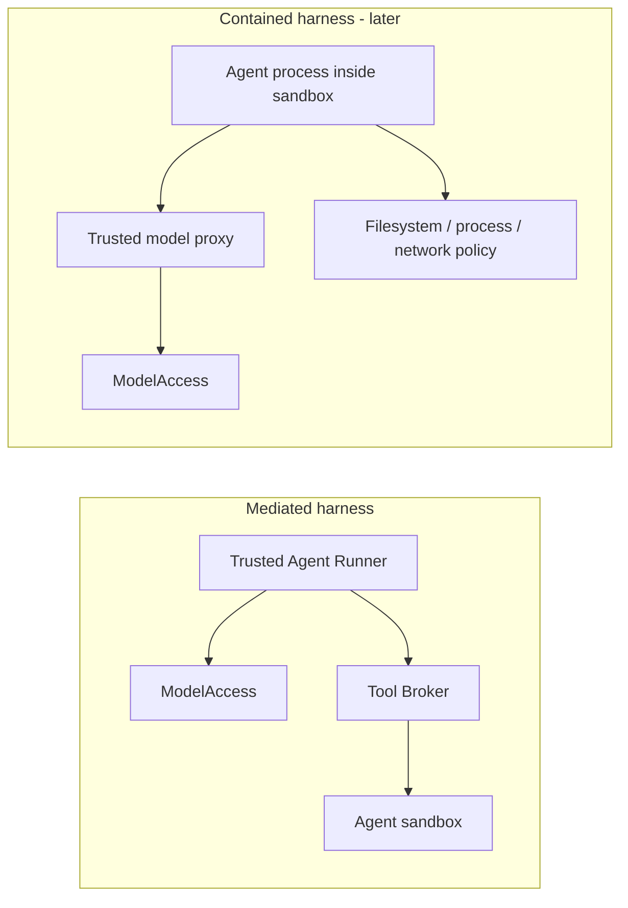
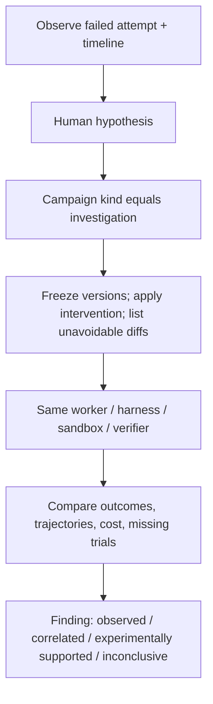
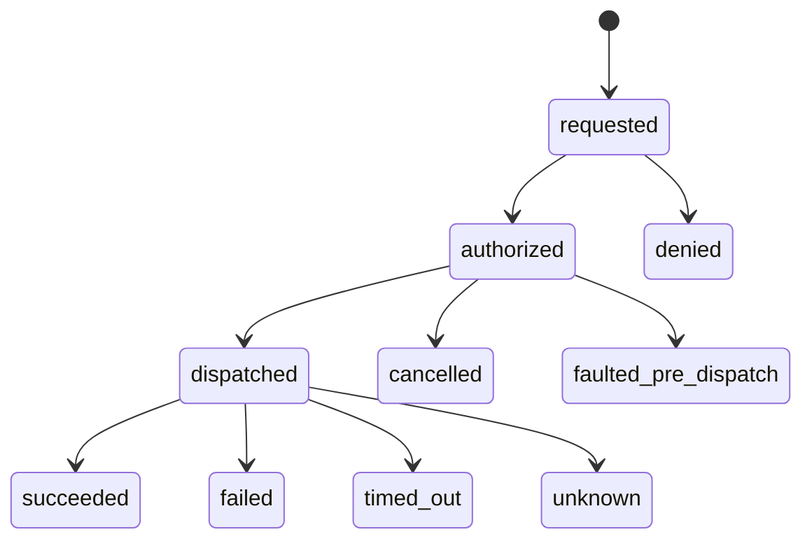
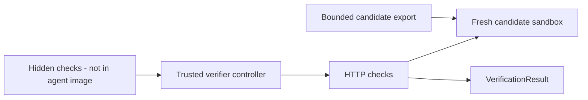
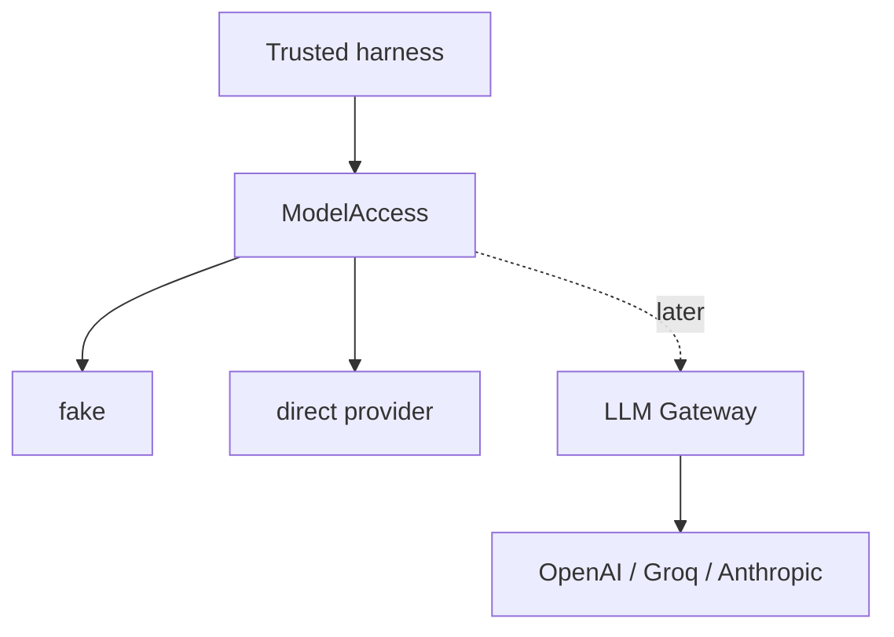

# Architecture — AgentProof

**Status:** Planned architecture. Nothing in this document is implemented.  
**Companion:** [ARCHITECTURE_DECISIONS.md](ARCHITECTURE_DECISIONS.md)  
**Vision source:** `AgentProof_Project_Vision_Engineering_Blueprint_v2.0.md`

This document describes the system we intend to build. It is the engineering contract for components, boundaries, interfaces, evidence, and invariants. Technology versions, cloud APIs, and external-agent compatibility remain subject to validation at the relevant milestone.

---

## 1. Purpose

AgentProof is a **reliability and execution intelligence platform for AI agents**. It runs real agents on real, verifiable tasks in isolated environments; tests reliability under declared adverse conditions; records evidence across agent, model, tools, workflow, and infrastructure; and supports repeatable investigations into what affected outcomes.

It is **not** an agent that performs business work, not an LLM proxy, and not merely an agent-comparison dashboard. Agent comparison is one capability of a broader execution and investigation system.

### 1.1 Product pillars

Four pillars share one execution and evidence foundation. They are product capabilities, not four services.

| Pillar | Question | Architectural implication |
|---|---|---|
| **A. Evaluation & Benchmarking** | What does an agent accomplish, reliably and efficiently? | Versioned inputs, trial matrix, independent verification, coverage-aware reports |
| **B. Reliability & Fault Testing** | How does it behave when dependencies misbehave? | Declared faults at recorded boundaries; dispatch-state semantics; recovery measurement |
| **C. Failure Provenance & Counterfactual Replay** | What evidence explains a failure, and how do outcomes change under a controlled intervention? | Typed evidence from day one; investigations are campaigns on the same executor |
| **D. Execution & Runtime Intelligence** | What does the environment cost, how does it fail, and do runtime choices change observed behavior? | Sandbox port, pinned profiles, honest CRI/runtime/OCI measurement |

The first task family is **Python HTTP API repair**. That family is the initial wedge, not the product boundary.

### 1.2 Design stance

- Modular Python backend; **two processes**, shared repository and release.
- Explicit module boundaries and ports; **no premature microservices**.
- Trusted control plane strictly separated from untrusted agent/candidate execution.
- Evidence before explanation. Independent verification over agent claims.
- Operational correctness (cancellation, cleanup, idempotency, budgets) is product behavior.
- Ambition is preserved by sequencing, not by shrinking pillars.

---

## 2. System context



AgentProof owns **task execution, tool mediation or containment policy, verification, evidence, and investigation**. Model providers and the existing LLM Gateway are **model backends**. Kubernetes and local Docker are **sandbox adapters**. They are not the product.

Untrusted sandboxes never receive provider credentials, gateway credentials, Kubernetes credentials, or control-plane database access.

---

## 3. Deployable shape

### 3.1 Processes

For a long initial period the system is a **modular monolith**:

| Process | Role |
|---|---|
| **API** | Authenticated submission, inspection, cancellation, query of campaigns/trials/attempts/evidence |
| **Worker** | Execute admitted attempts: harness, sandboxes, verification, evidence emission, cleanup |

Both share one PostgreSQL database, one artifact store interface, and the same library packages. Horizontal scale is a later operations concern, not an architectural split.

### 3.2 Library packages (not services)



| Package | Responsibility |
|---|---|
| `domain` | Identifiers, immutable versions, campaign/trial/attempt types, outcome taxonomy |
| `evidence` | Event envelope, provenance labels, artifact identity, append-only write API |
| `campaign` | Plan expansion, admission, cancellation, reports; investigation as a campaign kind |
| `harness` | Mediated runner + tool broker; later contained adapter + model proxy |
| `sandbox` | `SandboxManager` port and adapters |
| `verify` | Trusted verification controller; candidate launch; hidden-check access |
| `runtime` | Later: profile conformance, OCI inventory, preparation measurements |

`WorkflowCoordinator` is an **interface** used by the worker. The first implementation is a PostgreSQL-backed attempt state machine. A Temporal implementation is a planned milestone that must satisfy the same interface and the same recovery tests.

---

## 4. Trust boundaries

These are non-negotiable.



**Trusted:** API, worker, coordinator, PostgreSQL, artifact *metadata*, model credentials, tool authorization policy, verifier controller, hidden checks, Kubernetes/cloud credentials, ModelAccess.

**Untrusted:** agent-produced code, agent processes, candidate services, exported candidate trees, any contained open-source agent process.

### 4.1 Isolation rules

- Arbitrary **untrusted** agent- or model-generated code runs only on a **validated approved isolation profile** (first: `gke-containerd-gvisor`). Isolation conformance tests **fail closed**. There is no silent fallback to a weaker runtime.
- `local-docker-dev` is a **non-conforming development profile**. It may run **trusted, deterministic fixtures** only (known-correct/incorrect candidates, scripted workloads, fake-model predetermined edits). It **must not** execute arbitrary untrusted AI-generated code, and it **must not** be used to claim a security or isolation boundary.
- No privileged pods, host mounts, container-runtime sockets, automounted service-account tokens, or cloud permissions for agent/candidate workspaces.
- Block cloud metadata and control-plane reachability. Restrict egress to explicit, declared dependencies — preferably none, with dependencies vendored in the image.
- Candidate sandbox: **no egress**; **ingress only from the verifier**.
- Agent sandbox: no provider, gateway, Kubernetes API, or database reachability.
- Hidden tests and reference solutions **never** enter agent-visible starter content or image layers.
- LLM output is never authority to relax sandbox, tool, or network policy.
- External agent adapters are untrusted integrations until their control, file, network, secret, and tool model is analyzed.

### 4.2 Image and secret split

| Content | Where it lives |
|---|---|
| Starter application code, approved toolchain | Agent environment image (pinned digest) |
| Hidden HTTP behavioral checks, reference solutions | Verifier-only storage (PostgreSQL/object store), never the agent image |
| Model and cloud credentials | Trusted process environment / secret store |
| Candidate export | Size-capped, path-allowlisted archive, content-addressed |

Agent environment image ≠ verifier image ≠ verifier secret store.

---

## 5. Execution modes

Harness mode is a first-class contract. **Mediated** is implemented first. **Contained** is preserved so real open-source agents do not force a rewrite of sandbox identity, evidence, or faults.



| | Mediated | Contained |
|---|---|---|
| Agent process | Trusted runner (control plane) | Inside the approved sandbox |
| Model calls | `ModelAccess` from the runner | Sandbox egress **only** through a trusted model proxy |
| Tools | Mandatory Tool Broker | Policy at filesystem / process / network (broker may be partial or absent) |
| Fault injection | Broker-first (pre-dispatch error is the first trustworthy fault) | Proxy, network policy, resource limits, or other recorded mechanisms |
| Evidence | Runner, broker, sandbox, verifier events | Same envelope; sources include proxy and sandbox lifecycle; not all tool events will be broker events |
| First use | In-house adapter, walking skeleton | First serious open-source agent integration |

**Invariant:** `SandboxResource`, `attempt_id`, `EvidenceEvent`, `FaultDefinition`, and `VerificationResult` must not assume that every tool execution passes through the Tool Broker.

The first in-house adapter proves the **Mediated** contract. Contained is designed before it is implemented; it is not implemented until the mediated path, evidence model, and at least one investigation campaign are real.

---

## 6. Component responsibilities

| Component | Responsibility | Must not do |
|---|---|---|
| **API** | Versioned commands: register, plan, run, inspect, cancel. Stable IDs. Auth. | Execute untrusted code; hold long-running agent loops |
| **Campaign service** | Resolve immutable versions; expand trial matrix; freeze plan snapshots; typed campaign rules; reports | Mutate frozen plans; treat investigation as a second executor |
| **Workflow coordinator** | Admit work; drive attempt state; timers; cancellation; reconcile resources | Own authoritative outcomes independently of PostgreSQL; blindly retry non-idempotent dispatch |
| **Registry** | Task, agent, environment, runtime profile, verifier, fault, model-policy versions | Allow tag-based mutable environment identity |
| **Agent adapter** | Normalize one implementation to a harness contract | Leak extra tools or credentials; hide incomparable surfaces |
| **Mediated runner** | Agent/model/tool loop within budgets; emit AgentStep / ModelCall events | Talk to Kubernetes or providers from inside a sandbox |
| **Tool broker** | Authorize, mediate, inject declared faults, track execution IDs and dispatch state | Retry unknown-completion commands; execute tools in the control plane |
| **Contained adapter** (later) | Launch/constrain an external agent; attach model proxy; capture telemetry | Grant docker.sock, privileged mode, or control-plane credentials |
| **ModelAccess** | Pluggable backends; pin requested vs effective model; usage/error telemetry | Enable cache or provider fallback unless the experiment requests it |
| **Sandbox manager** | Create, locate, exec/export, monitor, destroy attempt-scoped sandboxes | Run untrusted AI-generated code on `local-docker-dev`; use a non-approved profile as if it were approved |
| **Verification controller** | Launch fresh candidate environment; run trusted external checks; emit VerificationResult | Place hidden checks in the agent workspace; trust agent-reported success |
| **Evidence store** | Append typed events; store artifact pointers and digests | Overwrite original observations; use ops dashboards as provenance |
| **Artifact store** | Immutable blobs (export, logs, traces, reports) | Treat candidate trees as OCI layers |
| **Results / analytics** | Coverage-aware scores, cost/time, comparisons, missing-trial accounting | Infer universal agent ranking from a small suite |
| **Investigation** | Hypothesis + intervention spec + child campaign + finding labels | Claim unique causation from a single alternate run |
| **Runtime / OCI analyzer** (later) | Profile metadata, image inventory, diffs, preparation timings | Claim CRI winners from unmatched GKE vs self-managed clusters |

---

## 7. Major interfaces

Interfaces are architectural ports. Names below are contracts, not a promise of final Python class names.

### 7.1 SandboxManager

```text
create(resource_id, profile, image_digest, limits, network_policy) -> SandboxHandle
wait_ready(handle, timeout)
exec(handle, command, cwd, timeout) -> ExecResult   # mediated tools; not used blindly in Contained
export(handle, allowlist, size_limit) -> ArtifactRef
destroy(handle)
status(handle) -> SandboxLifecycle
```

- `resource_id` is derived from `attempt_id` and role so create/destroy is reconcilable. Evaluation attempts that independently verify a candidate use roles `agent` and `candidate`. Trusted runtime-benchmark attempts may use a different role set (Section 8).
- Adapters: `local-docker-dev` (non-conforming; trusted/deterministic fixtures only), `gke-containerd-gvisor` (first approved untrusted profile), later lab profiles.
- Isolation class is recorded on the profile (`gvisor-untrusted` vs `runc-benchmark`). Mixing them silently is forbidden.

### 7.2 ModelAccess

```text
complete(ModelRequest) -> ModelResponse
```

`ModelRequest` includes model identity, messages, optional tool schema, temperature, token limits, timeout, and correlation (`campaign_id`, `trial_id`, `attempt_id`, `trace_id`).

Backends:

| Backend | When |
|---|---|
| `fake` | Unit/integration tests; deterministic fixtures; CI |
| `direct` | Walking skeleton and evaluation until/unless gateway is compatible |
| `gateway` | Optional later path, after compatibility audit |

Required telemetry: requested model, effective model, provider, `cached?`, `fallback_used?`, request id, latency, usage **or explicit `usage_missing`**. Never coerce missing usage to zero.

Evaluation-safe default: **no response cache, no unplanned provider fallback, no silent model swap**.

### 7.3 ToolBroker (Mediated)

```text
request(attempt_id, tool, args, step_id) -> ToolExecution
```

The broker owns authorization, fault application, dispatch, and the tool state machine (Section 11). The sandbox executes; the broker records.

### 7.4 Verifier

```text
verify(attempt_id, candidate_artifact, verifier_version, environment_version) -> VerificationResult
```

The controller is trusted. The candidate process is untrusted in a **fresh** sandbox. Checks are behavioral (HTTP status, payload, edge cases), not “the agent said it succeeded.”

### 7.5 WorkflowCoordinator

```text
submit(plan) / signal_cancel(attempt_id) / recover()
```

PostgreSQL remains the system of record for attempt identity, sandbox identity, cancellation, and authoritative outcome. A later Temporal implementation drives activities against that record. A killed sandbox process is **not** resumed because workflow state survived.

### 7.6 EvidenceWriter

```text
append(EvidenceEventDraft) -> EvidenceEvent   # store assigns seq
put_artifact(bytes, kind) -> ArtifactRef      # sha256 + URI
```

Events are append-only. Producers do **not** assign `seq` (Section 12.1). Redaction, if required, is a new event plus restricted read, not in-place rewrite of history. Derived findings link to evidence IDs and can be recomputed.

---

## 8. Campaign model

One substrate: **Campaign → Trial → Attempt**. Campaign *kind* changes required fields and validity rules, not the executor.

| Kind | Purpose | Distinct inputs |
|---|---|---|
| `evaluation` | Compare agents/tasks/conditions | Factor set, repetitions |
| `reliability` | Fault stress vs baseline | Fault profile / schedule |
| `investigation` | Controlled follow-up of observed outcomes | Parent attempt(s), hypothesis, intervention spec, held-constant list |
| `runtime` | Defensible environment/runtime measurement | Trusted scripted workload, declared cache/hardware conditions; **not** required to use the two-sandbox evaluation contract |



**Counterfactual replay** means new real attempts under a declared intervention. It is not bit-for-bit reproduction of a live model decision, and not a second execution engine.

Keep these distinct:

| Concept | Meaning |
|---|---|
| Trace viewing | Read recorded events |
| Recorded-effect replay | Later optional: feed captured tool/model outputs through an offline harness |
| Controlled re-execution | Rerun the real agent/task; live model output may differ |
| Counterfactual investigation | Compare actual runs produced under altered interventions |

---

## 9. Attempt lifecycle and data flow

The sequence below is the **agent-evaluation path** that independently verifies a candidate. Trusted `runtime` campaigns may allocate a different sandbox set (often a single measured workload sandbox) while still using attempt identity, evidence, and cleanup.

```mermaid
sequenceDiagram
    participant API
    participant PG as PostgreSQL
    participant W as Worker
    participant SM as SandboxManager
    participant H as Harness
    participant TB as ToolBroker
    participant MA as ModelAccess
    participant V as Verifier
    participant E as Evidence

    API->>PG: Freeze plan; create trials
    API->>W: Admit attempt
    W->>PG: Persist attempt_id and SandboxResource ids
    W->>SM: Create agent sandbox
    SM->>E: Lifecycle events
    W->>H: Run within budgets
    H->>MA: Model calls
    MA->>E: ModelCall events
    H->>TB: Tool requests
    TB->>SM: Dispatch or pre-dispatch fault
    TB->>E: ToolExecution / FaultEvent
    H->>SM: Stop; export allowlisted paths
    W->>SM: Create fresh candidate sandbox
    W->>V: Trusted HTTP checks
    V->>E: VerificationResult
    W->>PG: Finalize primary outcome
    W->>SM: Destroy both sandboxes
    SM->>E: Cleanup state
```

### 9.1 Stages

1. **Register / version** — task, starter content, tools, verifier, agent, model policy, environment digest, runtime profile, conditions, budgets.
2. **Plan** — resolve immutable versions; expand the matrix; store the snapshot **before** execution.
3. **Admit** — global concurrency and spend/token budgets.
4. **Allocate attempt** — persist `attempt_id` and stable resource identities first.
5. **Create agent sandbox** — profile required by workload class (approved isolation for untrusted code; `local-docker-dev` only for trusted fixtures); safe input staging.
6. **Run harness** — Mediated loop or later Contained process; budgets enforced outside the agent.
7. **Apply declared condition** — fault at a recorded boundary; capture whether dispatch occurred.
8. **Capture evidence** — steps, model calls, tools, lifecycle, ambiguities.
9. **Stop and export** — only permitted paths; digest the artifact.
10. **Verify independently** — when the campaign requires candidate verification: fresh candidate sandbox; trusted external checks. Omitted for trusted runtime-benchmark contracts that have no candidate artifact.
11. **Finalize** — primary outcome; preserve report, trace, artifacts; record agent vs infrastructure errors separately.
12. **Cleanup** — destroy resources; record success or failure to remove; reconcile after worker restart.

A failure at any stage is a first-class result. An infrastructure retry is a **new attempt**. It must not erase the first attempt’s resource/time cost or hide uncertainty about an earlier dispatched command.

### 9.2 Attempt state machine (coordinator v1)

```text
created → admitted → sandbox_allocated → agent_running → exported
        → verifying → finalized → cleaned

Branches: cancelled, failed_infrastructure, failed_invalid_config
```

Transitions are persisted in PostgreSQL. Cleanup is required on every terminal path, including cancellation and infrastructure failure.

---

## 10. Domain language

Final table schemas are decided with workload examples. The conceptual model is stable.

| Term | Meaning |
|---|---|
| `TaskVersion` | Immutable objective, starter, tools, expected external behavior, verifier identity |
| `AgentVersion` | Adapter/config/prompt/model-selection policy |
| `EnvironmentVersion` | Pinned image digest and platform architecture |
| `RuntimeProfileRevision` | Cluster/node/CRI/runtime/isolation class/resources/network |
| `VerifierVersion` | Hidden-check identity; not visible to the agent |
| `ModelPolicy` | Requested model, sampling, tool schema, cache/fallback flags |
| `Campaign` | Typed comparison or investigation design |
| `Trial` | One planned combination of task, agent, condition, profile, repetition |
| `Attempt` | One concrete execution of a trial; infrastructure retries create new attempts |
| `AgentStep` | Ordered model decision or action within an attempt |
| `ModelCall` | Provider request/response/usage/latency/error, correlated to the attempt |
| `ToolExecution` | Request, authorization, dispatch state, result or ambiguity |
| `FaultDefinition` / `FaultEvent` | Versioned target + mechanism + schedule, and the applied record |
| `VerificationResult` | Trusted checks and authoritative candidate outcome |
| `SandboxResource` | Attempt-owned identity, role, profile, lifecycle, cleanup state |
| `EvidenceEvent` | Typed envelope linked to attempt and source |
| `Artifact` | `sha256` + URI for export, patch, log, trace, or report |
| `Hypothesis` / `Intervention` / `Finding` | Investigation inputs and labeled conclusion |

Environment identity is an **image digest**, never a moving tag.

---

## 11. Tool dispatch protocol

Pre-dispatch failure, after-dispatch timeout, and unknown completion are different semantics.



| State | Meaning | Retry |
|---|---|---|
| `faulted_pre_dispatch` | Declared fault or policy error **before** the sandbox accepted work | Safe to treat as a completed (failed) tool event |
| `succeeded` / `failed` | Terminal observed result | Do not replay as the same execution |
| `timed_out` | Bound exceeded after dispatch | May leave sandbox work running; cleanup required |
| `unknown` | Dispatched; completion not observed (worker crash, lost result) | **Do not blindly retry**; new attempt if the trial continues |

`FaultDefinition` is **target + mechanism + schedule**, not “broker returns error.” The first implemented mechanism is a deterministic pre-dispatch tool error. Later mechanisms (delay, post-dispatch timeout, rate limit, network deny, resource pressure) and Contained-mode mechanisms must fit the same type.

---

## 12. Evidence contract

Product evidence is a first-class domain log. It is **not** OpenTelemetry, Grafana, or Kubernetes event export. Platform logs/metrics may exist later for operating API/workers; they are not the investigation substrate.

### 12.1 Envelope

```text
event_id
schema_version
type
source            # component that emitted it
campaign_id, trial_id, attempt_id
trace_id
seq               # assigned by the evidence store; see below
ts_utc            # secondary; multi-source clocks are not aligned
provenance        # planned | observed | reported_by_agent | verified | inferred
payload           # typed by type + schema_version
artifact_ids[]
causal_event_ids[]  # optional explicit predecessors; not inferred from seq
```

- PostgreSQL JSONB for event rows and small payloads.
- Object storage (local filesystem adapter or GCS) for blobs.
- Artifacts are content-addressed (`sha256` + URI).
- Control-plane entities (campaign, trial, attempt, outcome) are **stateful rows**, not event-sourced aggregates.
- Preserve original observations. Derived findings recompute and link to evidence IDs.
- No silent replacement of missing usage with zero. Record provider/model/version ambiguity explicitly.

### 12.1.1 Sequence-number ownership and concurrency

`seq` is a **per-attempt, strictly increasing integer** used as the primary timeline order. Wall-clock `ts_utc` is secondary and is not a global clock.

| Rule | Detail |
|---|---|
| **Owner** | The evidence store (PostgreSQL), not producers. `EvidenceWriter.append` is the only allocator. |
| **Callers** | Harness, tool broker, sandbox manager, ModelAccess, verifier, coordinator — any concurrent producer — submit a draft **without** `seq`. |
| **Allocation** | Atomic with the event insert, scoped to `attempt_id`. Recommended: increment an attempt-row counter in the **same transaction** as the insert (`UPDATE … RETURNING`), then write the event. Unique constraint on `(attempt_id, seq)` as a safety net. |
| **Concurrency** | Concurrent appends are serialized by the attempt-row counter. `seq` order is **commit/append order**, not the order producers started work. |
| **Restarts** | The counter lives on the attempt row, so a worker restart continues the same sequence. |
| **Gaps** | Dense sequences are expected when increment and insert share a transaction. Gaps, if they ever occur, do not invalidate the log; uniqueness and monotonicity matter, not density. |
| **Causality** | `seq` is a total order of recorded appends. It does **not** by itself prove that event *n* caused event *n+1* when producers ran concurrently. Steps that are causally related (tool request → dispatch → result) must set `causal_event_ids` (or an equivalent parent pointer). |
| **Forbidden** | In-memory counters in the worker; per-producer local sequences; client-supplied `seq`; inferring happens-before from `ts_utc` alone. |

### 12.2 Provenance and findings

| Label | Use |
|---|---|
| `planned` | What the frozen plan declared |
| `observed` | Platform-recorded event (broker dispatch, sandbox lifecycle, verifier HTTP result) |
| `reported_by_agent` | Agent text or self-claim; never authoritative |
| `verified` | Independent checker result |
| `inferred` | Derived statement; must cite evidence IDs |

Investigation findings:

| Label | Meaning |
|---|---|
| `observed` | Directly recorded |
| `correlated` | Co-occurs with the outcome; causation not shown |
| `experimentally_supported` | Follow-up campaign evidence warrants the claim under stated limits |
| `inconclusive` | Insufficient or conflicting evidence |

The system must not pronounce a unique root cause without justification.

### 12.3 What must be identifiable from day one

Stable `campaign_id`, `trial_id`, `attempt_id`, version IDs (task/agent/environment/profile/verifier), `trace_id`, tool execution IDs, model call IDs, fault IDs, sandbox resource IDs, artifact digests, and `seq`.

Rich investigation UI can wait. These identifiers must not require a later rewrite.

### 12.4 Retention and redaction

Prompts, hidden tests, candidate code, and logs are sensitive. Access control, redaction, bounded output, and retention are part of the contract. Do not assume artifacts are harmless or public.

---

## 13. Outcomes and failure taxonomy

Primary outcome is **mutually exclusive**. Secondary contributing events may coexist and remain linked.

| Primary outcome | Meaning |
|---|---|
| `success` | Authoritative behavior checks passed |
| `agent_failure` | Agent did not complete the task correctly in a valid environment |
| `budget_exceeded` | Wall time, model, tool, or resource budget stopped valid execution |
| `model_provider_error` | Model access unavailable/invalid/over limit; not a deliberate agent decision |
| `infrastructure_error` | Platform prevented trustworthy completion |
| `invalid_config` | Declared prerequisites not met |
| `cancelled` | Explicit cancellation protocol completed |
| `unknown_ambiguous` | Incomplete evidence or unknown outcome of a dispatched command |

Injected tool errors are **events**. They may or may not determine the primary outcome. Report policy must keep categories interpretable when several events occurred.

---

## 14. Verification path (first task family)

**Task:** repair a small Python HTTP API.  
**Agent:** inspect allowed files, run approved commands, edit permitted paths, submit a candidate.  
**Verifier:** a separate candidate environment launches the modified API; trusted external HTTP requests check status codes, payloads, edge cases, and the behavioral contract.



Every task used as a benchmark must have a **known-correct** and **known-incorrect** candidate validated before scores are treated as meaningful.

---

## 15. Model access and LLM Gateway seam



The existing LLM Gateway is an independent service (FastAPI, PostgreSQL, OpenAI-compatible `POST /v1/chat/completions`, streaming, cache, retries/fallback). AgentProof may use it as a **configurable backend**, never as an internal module.

**Known compatibility constraints (as of the architecture review):**

- Gateway messages are `role` + `content: str`. No `tools` / `tool_calls` surface.
- Semantic cache and cross-provider fallback default **on** — evaluation-unsafe for independent sampling and pinned model identity.
- Request logs store metadata, not bodies; no `trial_id` / `attempt_id` correlation.
- A host `localhost` gateway is not reachable from GKE as the same host.

Therefore gateway integration is **outside the initial critical path**. Direct and fake backends ship first. Integration requires:

1. An audit of actual request/response fields (tool calls, streaming, timeouts, errors).
2. An evaluation-safe gateway policy: pin model, disable cache unless the experiment measures cache, disable unplanned fallback, record provider failures, correlate IDs.
3. Authenticated network routing for non-local workers.
4. Retention of the direct-provider path so AgentProof remains testable without the gateway.

Tool execution always stays in AgentProof (broker and/or sandbox policy), not in the gateway.

---

## 16. Runtime profiles and later runtime/OCI programs

### 16.1 Profile classes

| Profile | Isolation class | Allowed use |
|---|---|---|
| `local-docker-dev` | **non-conforming** | Trusted, deterministic fixtures and contract tests only (known candidates, scripted workloads, fake-model predetermined edits). **Must not** execute arbitrary untrusted AI-generated code. **Must not** be treated as a security boundary. |
| `gke-containerd-gvisor` | `gvisor-untrusted` | First **approved** profile for untrusted agent-generated code. Required for any real LLM/agent run that can emit untrusted code. |
| Later lab: `containerd/runc`, `CRI-O/runc`, `CRI-O/crun` | `runc-benchmark` unless a stronger sandbox is validated | Trusted scripted workloads and *declared* comparisons; **not** a silent substitute for gVisor |

Untrusted execution (live model output, contained OSS agents, arbitrary generated code) requires a **validated approved isolation profile**. Isolation claims require that profile (or a later one that passes the same conformance tests). `local-docker-dev` cannot be used to satisfy those claims.

RuntimeClass selects an already configured handler. It does not install a CRI. Comparing containerd and CRI-O requires matched, separately provisioned environments.

### 16.2 Runtime lab (planned)

- Self-managed Kubernetes on Compute Engine for CRI-O; do not assume GKE can switch CRI to CRI-O.
- Reproducible bootstrap (Terraform or equivalent), pinned Kubernetes/kernel/runtime/CNI/storage/hardware.
- Trusted scripted workloads isolate runtime effects; full agent runs are end-to-end evidence but include stochastic model delay.
- Reports must include cluster kind, node image, cache state, versions, and residual confounders. GKE vs self-managed does not isolate “the CRI.”

This program uses the same `SandboxManager` and `RuntimeProfileRevision` types. It does not gate Pillars A–C.

### 16.3 OCI layer intelligence (planned)

- Inventory architecture, manifest/config digests, layer descriptors, compressed sizes, diff IDs.
- Compare environment revisions: shared/new/removed blobs, ordered layer graphs.
- Measure prepare/start under **declared** cache and network conditions.
- Shared blob digest proves content identity, not that a given node has the blob cached.
- Candidate edits in a writable workspace are **not** OCI layers.
- Warm pools, stargz/Nydus, Kata, WASI are research extensions after measurement, not requirements.

Observability is profile-limited: do not assume host eBPF or standard cgroup counters reveal gVisor internals.

---

## 17. Operational reliability and budgets

Enforced **outside** the agent:

- Global concurrency (fixed and small initially; no multi-tenant fairness scheduler).
- Wall time, tool-call count, model token/request budget, CPU/memory, storage, log/output size, resource expiry.
- Cloud spend kill-switch and cluster lifetime bounds when a cloud profile is in use.

Rules:

- Persist attempt and resource identities before create.
- Idempotent create/destroy keyed by `attempt_id` + role.
- Do not blindly retry non-idempotent dispatched work.
- Cancellation prevents future dispatch, terminates according to contract, and triggers cleanup — including already-dispatched tools where possible, recording residual unknown state if not.
- A sweeper expires orphans and records what it removed or failed to remove.
- Cleanup failure is a testable infrastructure outcome, not a hidden log line.

**Idempotency ownership**

| Boundary | Owner | Rule |
|---|---|---|
| Campaign / trial / attempt rows | PostgreSQL | Unique keys; attempts are never deleted |
| Sandbox create/destroy | `SandboxResource` named from `attempt_id` | Idempotent create; destroy on reconcile |
| Tool dispatch | Tool state machine | No retry of `dispatched → unknown` |
| Model call | `ModelCall` id | New id if retried; record cache/fallback |
| Verification | `VerificationResult` per attempt | Re-verify only as a new attempt if the candidate environment is gone |
| Finalization | Attempt unique transition | Exactly-one authoritative outcome |

---

## 18. Observability split

| Kind | Role |
|---|---|
| **Product evidence** | Domain `EvidenceEvent` log; investigation substrate |
| **Platform telemetry** | API/worker structured logs with correlation IDs; later metrics if needed to operate the control plane |

OpenTelemetry, Prometheus, and Grafana are **not** part of the initial architecture. They must not become the place where trial provenance lives.

A thin CLI/API is the first interface. A richer UI is justified when it reveals measured capabilities — first likely surface: investigation timeline. UI is not a pillar.

---

## 19. Architectural invariants

1. Independent verification is authoritative; agent self-report is not.
2. Arbitrary untrusted AI-generated code runs only on a validated **approved** isolation profile. `local-docker-dev` is restricted to trusted/deterministic fixtures and is never a security boundary.
3. Agent-evaluation attempts that independently verify a candidate use two sandboxes (agent workspace + fresh candidate); export is bounded and digested. Trusted runtime-benchmark campaigns may use a different execution contract.
4. Hidden checks never enter agent-visible layers.
5. Infrastructure retry = new attempt.
6. Unknown dispatch is terminal for certainty; it is not reclassified as success or a clean tool failure.
7. Investigation uses the same executor as evaluation.
8. Event `seq` is assigned only by the evidence store, is monotonic per attempt under concurrent producers, and is append order — not proof of causality. Wall clocks are annotated, not a global order.
9. Missing measurements are missing, not zero.
10. Runtime claims name the profile, isolation class, cache state, and residual confounders — or they are not emitted.
11. Conformance tests fail closed; no silent weaker runtime.
12. LLM Gateway is optional; AgentProof must run with `fake` and `direct` ModelAccess.
13. External agents are untrusted until analyzed; Contained mode must not require docker.sock or control-plane credentials.
14. Primary outcomes are mutually exclusive; secondary events remain attached.

---

## 20. Intentionally deferred (not abandoned)

These remain project goals. They are not present in the walking skeleton and must not be treated as already designed in detail:

- Temporal coordinator implementation and its recovery acceptance tests
- GKE gVisor approved profile, NetworkPolicy, image pinning, spend limits
- Contained harness and the first open-source agent adapter
- Runtime lab (CRI-O / runc / crun) and OCI layer analyzer
- Evaluation-safe LLM Gateway backend
- Investigation UI, clustering, rule-based hypothesis suggestions, differential traces
- Recorded-effect replay
- Warm pools, lazy image loading, Kata, WASI
- Multi-tenant scheduling, SSO, public benchmark publication policy
- Helm, OpenTelemetry, Prometheus/Grafana

Deferred means **sequenced**, not optional, unless a later decision record explicitly drops an item.

---

## 21. Development environment

Container execution (local Docker adapter, kind, gVisor tooling, later cluster clients) assumes a **Linux environment**. WSL2 or a Linux VM is the recommended direction. The actual developer environment will be confirmed before setup is finalized. The API may be developed on Windows; the execution path must not depend on Docker Desktop as if it were an approved sandbox.

---

## 22. Related documents

| Document | Role |
|---|---|
| Vision / engineering blueprint v2.0 | Product intent and constraints |
| [ARCHITECTURE_DECISIONS.md](ARCHITECTURE_DECISIONS.md) | Accepted decisions, reasoning, pending validation |
| [LEARNING_ROADMAP.md](LEARNING_ROADMAP.md) | Technology and concept map, ordered by engineering dependencies |
| [ROADMAP.md](ROADMAP.md) | Phased engineering implementation plan |
| `DEVELOPMENT_LOG.md` | Created when implementation tasks begin |
